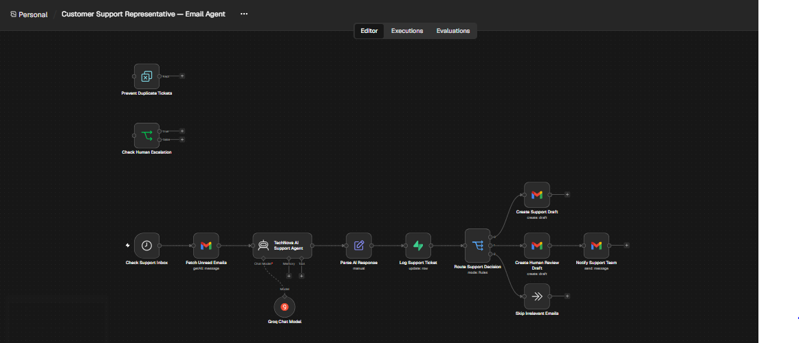
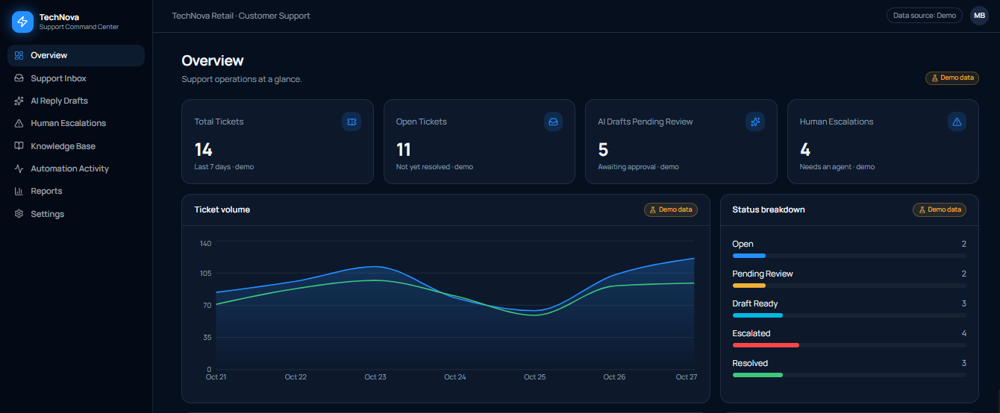
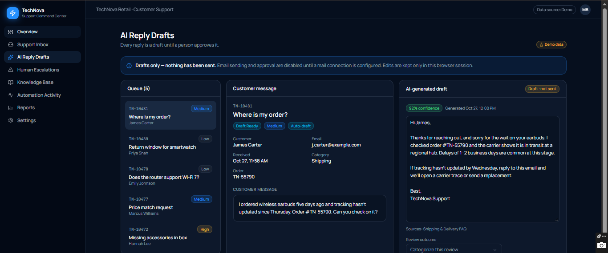
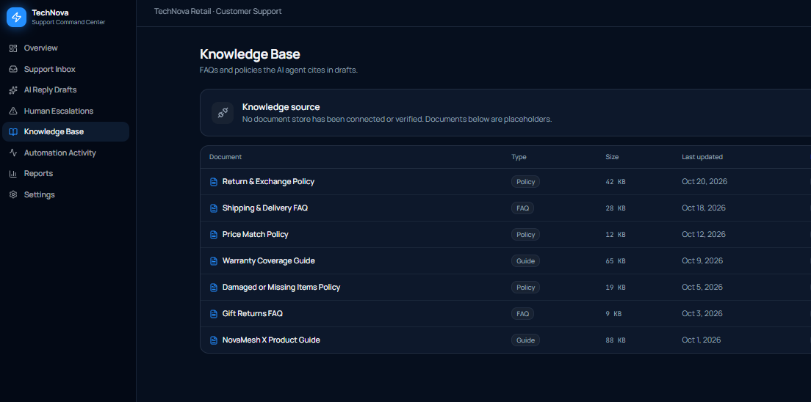
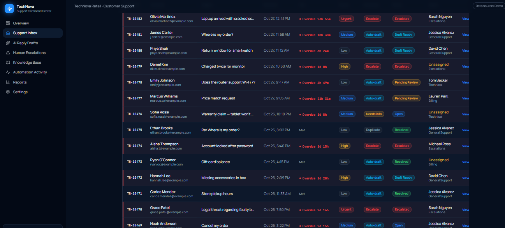
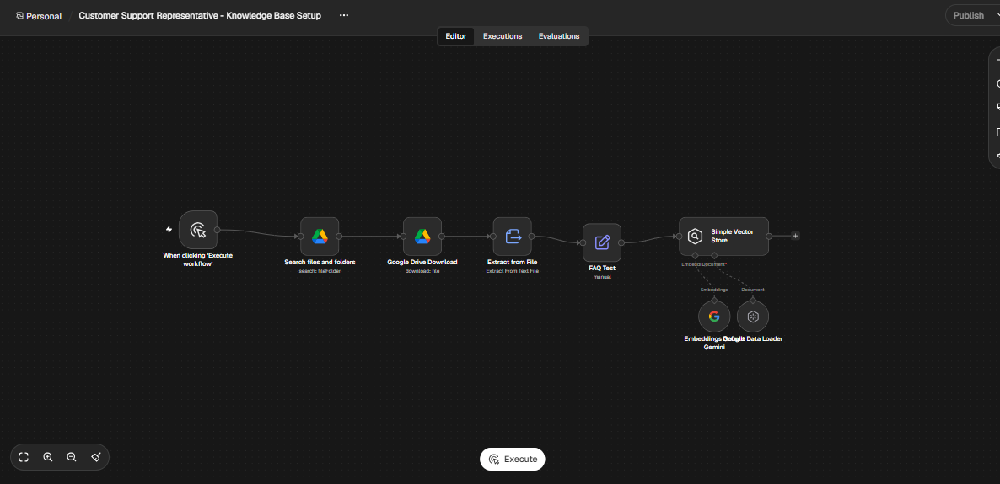

# 🤖 AI Customer Support Representative

An AI-powered customer support automation system built with **n8n, Groq, Google Gemini, Gmail, Google Drive, and Supabase**.

This project demonstrates how businesses can use AI agents and workflow automation to manage customer support emails, generate suggested responses, classify customer inquiries, maintain a knowledge base, and escalate complex cases to human representatives.

## 🚀 Project Overview

Customer support teams often deal with a high volume of repetitive emails, including shipping inquiries, return requests, refund questions, and general product-related concerns.

Manually reviewing every email can consume valuable time and delay customer responses.

This project addresses that challenge by introducing an AI-powered Customer Support Representative that analyzes incoming emails, identifies their intent, generates appropriate response drafts, and determines when human intervention is required.

The solution is designed to improve support efficiency while maintaining human oversight over important customer interactions.

## ✨ Key Features

### 1. AI-Powered Email Analysis
- Retrieves customer emails through Gmail.
- Analyzes email content, subject, and sender information.
- Understands customer intent and identifies the type of inquiry.
- Generates context-aware suggested responses.

### 2. Intelligent Email Classification

The AI agent classifies incoming emails into three categories:

| Classification | Description |
|---|---|
| DRAFT | Routine inquiries that can be answered using approved company policies. |
| ESCALATE | Complex cases requiring human review or additional investigation. |
| SKIP | Spam, promotional emails, and unrelated messages. |

### 3. Automated Email Draft Generation
- Generates professional and personalized email responses.
- Creates suggested replies directly in Gmail.
- Maintains human control before sending responses.
- Avoids unsupported claims and unauthorized actions.

### 4. Human-in-the-Loop Escalation
- Identifies complaints and sensitive customer requests.
- Escalates order-specific and policy-exception cases.
- Creates a draft acknowledgment for human review.
- Notifies the support team when intervention is required.

### 5. Knowledge Base Integration

A separate n8n workflow prepares the customer support knowledge base.

It:
- Searches for company knowledge-base documents in Google Drive.
- Downloads and extracts document content.
- Processes the information for AI retrieval.
- Uses Google Gemini embeddings.
- Stores document information in an in-memory vector store.

The knowledge base provides approved information about shipping, returns, refunds, payments, product questions, and customer support policies.

### 6. Database & Support Ticket Management
- Logs support ticket information in Supabase.
- Records email classification and suggested responses.
- Tracks ticket status.
- Stores escalation reasons for support-team review.

### 7. Workflow Reliability
- Includes duplicate prevention.
- Uses an error-handling workflow.
- Separates routine support requests from cases requiring human attention.

## 🧰 Technology Stack

| Technology | Purpose |
|---|---|
| n8n | Workflow automation and orchestration |
| Groq API | AI model integration |
| LLM | Email understanding and response generation |
| Google Gemini | Knowledge-base embeddings |
| Gmail | Email retrieval, drafts, and notifications |
| Google Drive | Knowledge-base document storage |
| Supabase | Support ticket database |
| Vector Store | Knowledge retrieval |

## ⚙️ Workflow Architecture

The project consists of two main workflows.

### Workflow 1: Knowledge Base Setup

```text
Manual Trigger
      ↓
Google Drive Search
      ↓
Download Knowledge Base
      ↓
Extract Document Text
      ↓
Prepare FAQ Content
      ↓
Google Gemini Embeddings
      ↓
Simple Vector Store
```

This workflow prepares company documentation so that the support system can use approved information when responding to customer inquiries.

### Workflow 2: AI Customer Support Email Agent

```text
Schedule Trigger
      ↓
Fetch Customer Emails
      ↓
AI Customer Support Agent
      ↓
Analyze & Classify Email
      ↓
Parse AI Response
      ↓
Log Support Ticket in Supabase
      ↓
Route Support Decision
      │
      ├── DRAFT
      │     ↓
      │   Create Gmail Draft
      │
      ├── ESCALATE
      │     ↓
      │   Create Human Review Draft
      │     ↓
      │   Notify Support Team
      │
      └── SKIP
            ↓
          Skip Irrelevant Email
```

## 🖼️ Project Preview

### Main Workflow



### Database & Support Ticket Management



### Database Configuration







### Additional Project Screenshot



### Demo Video

A demonstration of the project is available in the repository:

[Watch or download the project demo](TechNova_LinkedIn_Landscape_16x9.mp4)

## 📂 Project Structure

```text
Customer-Support-Representative/
│
├── Customer Support Representative - Knowledge Base Setup.json
├── Customer Support Representative — Email Agent.json
│
├── Main.PNG
├── db.PNG
├── db2.PNG
├── db3.PNG
├── db4.PNG
├── pic.PNG
│
├── TechNova_LinkedIn_Landscape_16x9.mp4
│
└── README.md
```

## 🛠️ Installation & Setup

### Prerequisites

Before importing the workflows, prepare:

- An n8n Cloud or self-hosted instance.
- A Gmail account with OAuth2 access.
- A Google Drive account.
- A Groq API key.
- A Google Gemini API key.
- A Supabase project and database.
- A company knowledge-base document.

### 1. Clone the Repository

```bash
git clone https://github.com/mujtabamajidgit/Customer-Support-Representative.git
```

### 2. Import the Workflows

Import both JSON files separately into your n8n workspace:

1. Customer Support Representative - Knowledge Base Setup.json
2. Customer Support Representative — Email Agent.json
